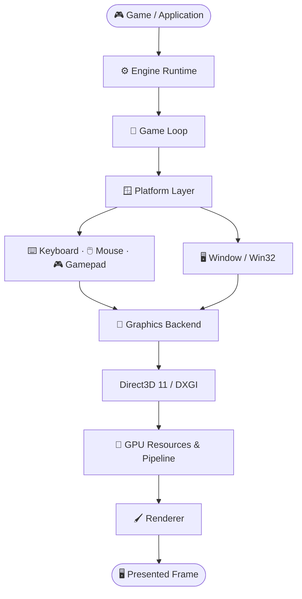

# 🎮 SA2DGE

### Shreyas's Advanced 2D Game Engine

**A custom 2D game engine built from scratch in C#.**

*Understand the systems. Build the engine. Learn how games work under the hood.*

---

## 🧭 What Is SA2DGE?

SA2DGE is a modular 2D game engine project focused on understanding and implementing the systems that make a game engine work. It is being built subsystem by subsystem, from the application lifecycle and input handling to the graphics backend and sprite rendering.

The goal is to create a foundation on which 2D games can eventually be built, while keeping the engine architecture understandable, testable, and modular.

## 🏗️ Engine Architecture

The diagram below shows the high-level rendering flow through SA2DGE.

### 🔍 How It Works

1. **Runtime:** Starts the engine, manages its lifecycle, and coordinates the game loop.
2. **Platform:** Connects the engine to Windows, manages the native window, and processes input.
3. **Graphics backend:** Creates and manages GPU resources and sends rendering commands through Direct3D 11.
4. **Renderer:** Uses geometry, shaders, textures, and rendering state to draw 2D content.
5. **Presentation:** The completed frame is presented to the application window.

## 🧰 Technology Stack

| Area | Technology |
|---|---|
| Language | C# |
| Runtime | .NET 10 |
| Operating-system integration | Windows / Win32 |
| Graphics API | Direct3D 11 / DXGI |
| Graphics bindings | Vortice |
| Gamepad input | XInput |
| Version control | Git / GitHub |

## 🛠️ Development Principles

SA2DGE is developed in small, testable steps. Each subsystem is understood, designed, implemented, tested, and connected to the rest of the engine before the next layer is built.

The current foundation includes the runtime, window and input backends, D3D11 graphics resources, basic geometry rendering, and early 2D texture and sprite-rendering functionality. The architecture will continue to evolve as new engine systems are added.

## ⚠️ Educational Use Only — No Copying Allowed

This repository is **public for educational viewing and technical study**. You may inspect the source code to understand the engine's architecture, logic, mathematics, and general programming concepts.

- ✅ **Permitted:** View and study the publicly available source code to learn how the engine is structured.
- ❌ **Not permitted without prior written permission:** Copying or reproducing the source code, copy-pasting it into another project, modifying it, redistributing it, or incorporating it into another engine, game, library, or product.

**Viewing the source does not grant permission to use SA2DGE as a game engine.** If an official compiled release is published for Windows, macOS, or another platform, use of that release will be governed by its separate license or end-user terms.

Read [`LICENSE`](LICENSE) for the full terms. Third-party dependencies remain subject to their own licenses.

> **Important:** This repository's public visibility allows people to view and technically download or fork its contents. The license states the permitted and prohibited uses; it does not technically prevent copying. Previously granted rights under any earlier license may continue to apply to copies distributed under that license.

---

**SA2DGE — Shreyas's Advanced 2D Game Engine**

*Built to understand the technology behind 2D games.*

