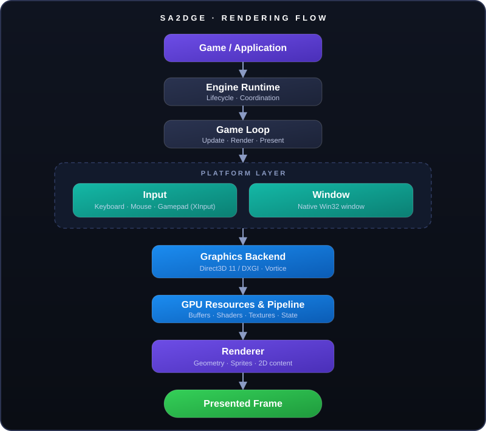
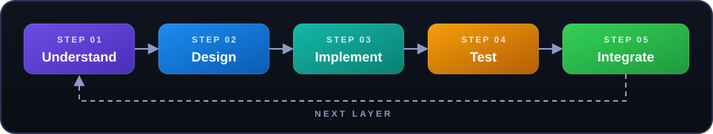

 

# 🎮 SA2DGE

### Shreyas's Advanced 2 Dimensional Game Engine

**A custom 2D game engine built from scratch in C#.**

*Understand the systems. Build the engine. Learn how games work under the hood.*

 

 

[Overview](#-what-is-sa2dge) •
[Architecture](#%EF%B8%8F-engine-architecture) •
[Features](#-current-foundation) •
[Tech Stack](#-technology-stack) •
[Principles](#%EF%B8%8F-development-principles) •
[License](#%EF%B8%8F-license--usage)

---

## 🧭 What Is SA2DGE?

**SA2DGE** is a modular 2D game engine focused on understanding and implementing the systems that make a game engine work. It is built subsystem by subsystem, from the application lifecycle and input handling to the graphics backend and sprite rendering.

The goal is a solid foundation on which 2D games can eventually be built, while keeping the engine architecture **understandable**, **testable**, and **modular**.

> 💡 **Philosophy:** every layer is understood, designed, implemented, and tested before the next one is added.

---

## 🏗️ Engine Architecture

The diagram below shows the high-level rendering flow through SA2DGE.

  

### 🔍 How It Works

| Step | Layer | Responsibility |
|:---:|---|---|
| **1** | ⚙️ **Runtime** | Starts the engine, manages its lifecycle, and coordinates the game loop. |
| **2** | 🪟 **Platform** | Connects the engine to Windows, manages the native window, and processes input. |
| **3** | 🎨 **Graphics Backend** | Creates and manages GPU resources and sends rendering commands through Direct3D 11. |
| **4** | 🖌️ **Renderer** | Uses geometry, shaders, textures, and rendering state to draw 2D content. |
| **5** | 🖥️ **Presentation** | The completed frame is presented to the application window. |

---

## ✨ Current Foundation

| Subsystem | Status |
|---|:---:|
| ⚙️ Engine runtime & lifecycle | ✅ Implemented |
| 🪟 Window backend (Win32) | ✅ Implemented |
| ⌨️ Input backends (keyboard, mouse, gamepad) | ✅ Implemented |
| 🧩 Direct3D 11 graphics resources | ✅ Implemented |
| 🔺 Basic geometry rendering | ✅ Implemented |
| 🖼️ 2D texture & sprite rendering | 🚧 Early stage |
| 🚀 Additional engine systems | 🗺️ Planned |

> The architecture will continue to evolve as new engine systems are added.

---

## 🧰 Technology Stack

| Area | Technology |
|---|---|
| 💻 **Language** | C# |
| 🟣 **Runtime** | .NET 10 |
| 🪟 **OS Integration** | Windows / Win32 |
| 🎨 **Graphics API** | Direct3D 11 / DXGI |
| 🔗 **Graphics Bindings** | Vortice |
| 🎮 **Gamepad Input** | XInput |
| 🌿 **Version Control** | Git / GitHub |

---

## 🛠️ Development Principles

SA2DGE is developed in small, testable steps. Each subsystem follows the same cycle:

  

---

## ⚖️ License & Usage

### ⚠️ Educational Use Only — No Copying Allowed

This repository is **public for educational viewing and technical study**. You may inspect the source code to understand the engine's architecture, logic, mathematics, and general programming concepts.

| | Action | Permission |
|:---:|---|---|
| ✅ | View and study the public source code to learn how the engine is structured | **Permitted** |
| ❌ | Copy or reproduce the source code, or paste it into another project | **Requires prior written permission** |
| ❌ | Modify or redistribute the source code | **Requires prior written permission** |
| ❌ | Incorporate it into another engine, game, library, or product | **Requires prior written permission** |

**Viewing the source does not grant permission to use SA2DGE as a game engine.** If an official compiled release is published for Windows, macOS, or another platform, use of that release will be governed by its separate license or end-user terms.

Read [`LICENSE`](LICENSE) for the full terms. Third-party dependencies remain subject to their own licenses.

> [!IMPORTANT]
> This repository's public visibility allows people to view and technically download or fork its contents. The license states the permitted and prohibited uses; it does not technically prevent copying. Previously granted rights under any earlier license may continue to apply to copies distributed under that license.

<b>🔒 What does "proprietary license" mean?</b>

 

A proprietary license means that **SA2DGE is privately owned, and its source code is not free to copy, modify, redistribute, or use in other projects without explicit written permission.**

The source code is publicly available for educational viewing and learning only. Public access does not grant ownership or usage rights. Any future official engine release will be governed by its own separate license.

---

### 🎮 SA2DGE — Shreyas's Advanced 2 Dimensional Game Engine

*Built to understand the technology behind 2D games.*

 

